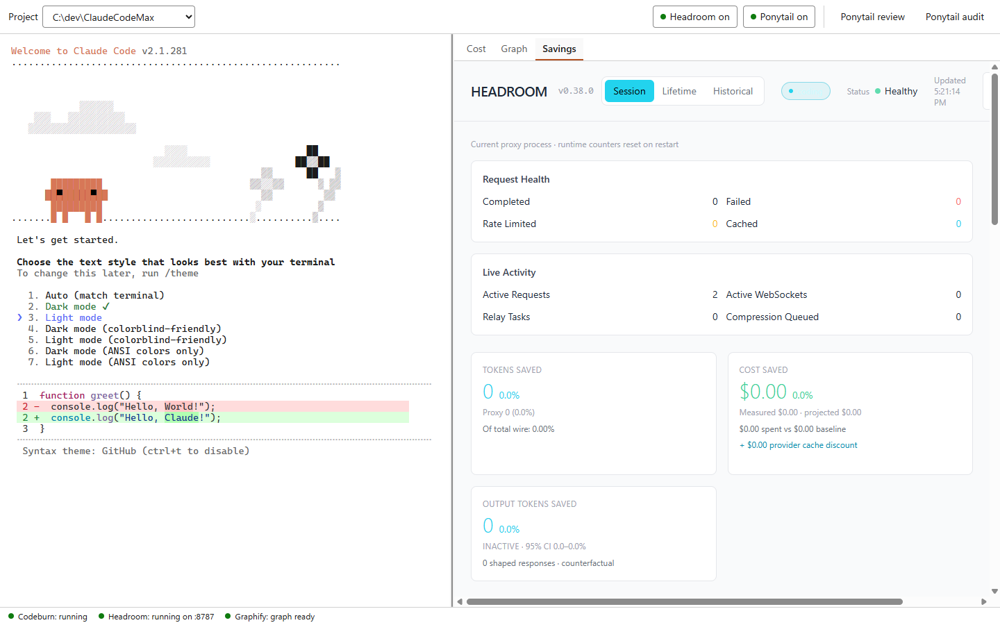
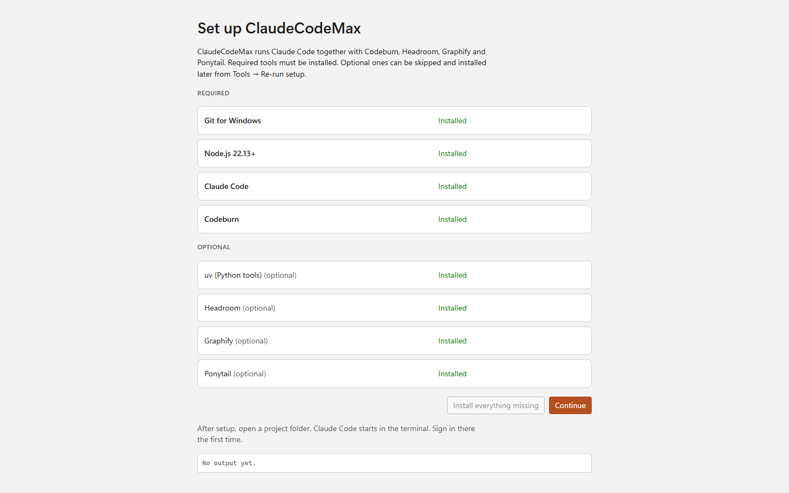

<div align="center">


# ClaudeCodeMax

**Claude Code in one Windows 11 window, with your plan usage, token savings and memory right beside it.**

[](https://github.com/countryboysplay/ClaudeCodeMax/releases) [](https://github.com/countryboysplay/ClaudeCodeMax/actions/workflows/ci.yml) [](LICENSE) [](#install) [](https://www.electronjs.org/)

<br>

<a href="https://github.com/countryboysplay/ClaudeCodeMax/releases"></a>

<sub>Free and open source · Per-user install, no admin rights · Unofficial community project</sub>

<br><br>

<picture>
  <source media="(prefers-color-scheme: dark)" srcset="docs/screenshots/dashboard-savings-dark.png">
  
</picture>

</div>

<br>

## Why ClaudeCodeMax?

Claude Code is great in a terminal. But to see how much of your plan you've used, or how many tokens a proxy saved, you end up juggling extra terminals, browser tabs and install guides.

ClaudeCodeMax puts all of it in one window. A **usage bar** shows your 5-hour and weekly plan limits, how full the context is and whether the prompt cache is still warm. It also installs two community tools for you and runs them next to Claude Code:

- **[Headroom](https://github.com/headroomlabs-ai/headroom)** compresses context through a local proxy, so you send fewer tokens.
- **[Ponytail](https://github.com/dietrichgebert/ponytail)** is a Claude Code plugin that keeps Claude's code minimal.

It also gives Claude a **persistent memory** that carries what it learned from one session into the next.

You don't have to open a second terminal.

## Features

<table>
  <tr>
    <td width="50%" valign="top">
      <h3>📊 Usage at a glance</h3>
      The bar at the bottom shows your <b>5-hour</b> and <b>weekly</b> plan limits with their reset times, how full the <b>context</b> is, the session's cost at API prices and whether the <b>cache</b> is warm. A limit turns amber at 80% and red at 95%. It comes straight from Claude Code's own status line data, so there's nothing extra to install.
    </td>
    <td width="50%" valign="top">
      <picture>
        <source media="(prefers-color-scheme: dark)" srcset="docs/screenshots/dashboard-savings-dark.png">
        
      </picture>
      <h3>📉 Token savings</h3>
      With <b>Headroom on</b>, Claude Code talks to a local Headroom proxy. The <b>Savings</b> tab shows its live dashboard.
    </td>
  </tr>
  <tr>
    <td width="50%" valign="top">
      <picture>
        <source media="(prefers-color-scheme: dark)" srcset="docs/screenshots/wizard-dark.png">
        
      </picture>
      <h3>🧰 One-click setup</h3>
      On first run, a setup wizard checks for each tool and installs anything missing. You can watch the output as it runs.
    </td>
  </tr>
</table>

<table>
  <tr>
    <td width="33%" valign="top"><b>🪮 Ponytail built in</b><br>Turn the plugin on or off from the header. One-click <i>Ponytail review</i> and <i>Ponytail audit</i> buttons.</td>
    <td width="33%" valign="top"><b>🔄 Updates itself</b><br>The app updates from GitHub Releases. The tools update when you choose <i>Check for tool updates</i>.</td>
    <td width="33%" valign="top"><b>🌗 Light and dark</b><br>Follows your Windows theme. WCAG AA contrast, visible focus and a full keyboard path.</td>
  </tr>
  <tr>
    <td width="33%" valign="top"><b>🩺 Self-healing services</b><br>If a background tool crashes, the app restarts it (up to 3 tries) and shows its last output.</td>
    <td width="33%" valign="top"><b>🧹 Clean exit</b><br>When you quit, the app ends every process it started, including Claude Code.</td>
    <td width="33%" valign="top"><b>🔒 Locked-down panels</b><br>Panels only load <code>localhost</code> pages. Other links open in your browser.</td>
  </tr>
  <tr>
    <td width="33%" valign="top"><b>🧠 Persistent memory</b><br>After each session, a background distiller saves what's worth keeping. The next session starts with an index of it. The <b>Memory</b> tab shows what it's doing.</td>
  </tr>
</table>

## How it works

```
┌──────────────────────────────────────────────────────────────────────────┐
│ Project: C:\code\myapp  v     Headroom: on   Ponytail: on   review audit │
├────────────────────────────────────┬─────────────────────────────────────┤
│                                    │  [Savings] [Memory]                 │
│   Claude Code terminal             │                                     │
│   (xterm.js + node-pty, runs       │   the selected tool's own web UI    │
│    `claude` in your project)       │   (an embedded <webview>)           │
│                                    │                                     │
├────────────────────────────────────┴─────────────────────────────────────┤
│ 5h: 42%  Week: 18%  Context: 31%  Cache: warm 4m    Headroom: running    │
└──────────────────────────────────────────────────────────────────────────┘
```

1. **You open a project folder.** ClaudeCodeMax starts `claude` in that folder, inside the built-in terminal.
2. **Usage** comes from Claude Code's status line. The app registers a small status line script for its sessions. After each response, Claude Code hands the script your plan limits, context use, session cost and cache state. The script saves them for the usage bar and prints a short summary in the terminal.
3. **Headroom** (when on) runs `headroom proxy` on `127.0.0.1`. Claude Code starts with `ANTHROPIC_BASE_URL` pointed at the proxy. Headroom's dashboard is the **Savings** tab. Turning Headroom on or off restarts the Claude session, because Claude Code only reads that variable when it starts.
4. **Ponytail** runs inside Claude Code as a plugin. The header toggle turns it on or off with `claude plugin enable|disable`. The two buttons type `/ponytail-review` and `/ponytail-audit` into the session.
5. **Memory** runs through Claude Code hooks on the sessions the app launches. When a session starts, Claude gets an index of what it remembers. When a session ends, the app distills the session into memory in the background. See [Memory](#memory).

If Headroom's default port is taken, the app picks a free one and passes it to both Headroom and Claude.

## Install

1. Download `ClaudeCodeMax-Setup-x.y.z.exe` from **[Releases](https://github.com/countryboysplay/ClaudeCodeMax/releases)**.
2. The installer isn't code-signed, so Windows SmartScreen may say **"Windows protected your PC"**. Click **More info → Run anyway**.
3. The installer is per-user, so you don't need admin rights. You can choose the install folder.
4. On first launch, the **setup wizard** checks for these tools and installs anything missing:

   | Tool | Required | Installed with |
   |---|:---:|---|
   | Git for Windows | ✅ | `winget install --id Git.Git` |
   | Node.js 22.13+ | ✅ | `winget install --id OpenJS.NodeJS.LTS` |
   | Claude Code | ✅ | the official installer (`irm https://claude.ai/install.ps1 \| iex`) |
   | uv (Python tools) | for Headroom | `winget install --id astral-sh.uv` |
   | Headroom | optional | `uv tool install --python 3.13 "headroom-ai[all]"` |
   | Ponytail | optional | `claude plugin marketplace add DietrichGebert/ponytail`, then `claude plugin install ponytail@ponytail -y` |

   You can skip any optional tool and install it later from **Tools → Re-run setup**. After each install, the app reloads your PATH, so you don't need to reboot.
5. **Open a project folder.** Claude Code starts in the terminal. The first time, **sign in there** using Claude Code's own sign-in. ClaudeCodeMax never sees or stores your credentials.

## Using it

| Where | What it does |
|---|---|
| **Project ▾** (header) | Pick a folder or reopen a recent one (the last 10 are saved). **File → Open Project…** or <kbd>Ctrl</kbd>+<kbd>Shift</kbd>+<kbd>O</kbd> does the same. |
| **Model ▾** (header) | **Sonnet**, **Opus plans, Sonnet builds** (`opusplan`) or **Opus**. Switches the running session in place with `/model`, so the conversation stays, and starts later sessions on that model. *Claude Code default* leaves the choice to your own Claude Code settings. Sonnet costs the least; `opusplan` keeps Opus for planning only. |
| **Headroom on/off** | Routes Claude through the Headroom proxy, or not. Claude restarts so the change takes effect. |
| **Lean on/off** | Keeps skill descriptions, plugins and claude.ai connectors out of Claude's context in app sessions. See [Lean mode](#lean-mode). Claude restarts so the change takes effect. |
| **Ponytail on/off** | Turns the Ponytail plugin on or off in Claude Code, then restarts Claude. |
| **Ponytail review / audit** | Types `/ponytail-review` (over-engineering review of your changes) or `/ponytail-audit` (whole-repo audit) into Claude. |
| **Usage bar** (bottom) | Your 5-hour and weekly plan limits, context use, session cost at API prices and cache state. Hover an item for details. It fills in after Claude's first reply in a session. The cache turns amber in its last 5 minutes (*cold in 3m*), so you can send your next message before it expires. |
| **Compact / Clear** (usage bar) | Shown once the context is 60% full. **Compact** runs `/compact` to shrink the conversation; **Clear** runs `/clear` after asking. Long contexts cost more per message and make Claude less accurate. |
| **Divider** | Drag it, or focus it and use the arrow keys, to resize the terminal and the panels. The app remembers the split and the last tab you used. |
| **Tools → Check for tool updates** | Stops the tools, runs `uv tool upgrade headroom-ai`, `claude update` and `claude plugin update ponytail@ponytail`, then starts everything again. The output is shown as it runs. |
| **Tools → Re-run setup** | Opens the setup wizard again, for example to install a tool you skipped. |
| **Memory tab** | Shows how many sessions are waiting to be distilled, recent memory changes and the distiller's log. **Open memory folder** opens it in Explorer. |
| **Help → Third-party licenses** | Opens [THIRD_PARTY_NOTICES.md](THIRD_PARTY_NOTICES.md). |
| <kbd>F6</kbd> | The terminal sends every key to Claude, including <kbd>Tab</kbd>. Press <kbd>F6</kbd> to move keyboard focus out of the terminal. |
| <kbd>Ctrl</kbd>+<kbd>Shift</kbd>+<kbd>C</kbd> | Copies the selected text in the terminal. |

The Headroom, Lean and Ponytail toggles restart Claude with `--continue`, so your conversation comes back. While the prompt cache is still warm they ask first, because the restart loses the cache and makes the next message cost more.

When Claude exits, the terminal shows **Session ended** with a **Restart** button. If the Headroom proxy goes down while Claude is using it, a banner lets you restart Headroom or relaunch Claude without it. The app never switches Claude off the proxy without asking.

## Lean mode

Every skill description, plugin and MCP connector Claude Code loads is re-sent on **every turn**, whether Claude uses it or not. On a typical setup that's more than half of a fresh session's context. Lean mode (on by default) trims it for the sessions the app launches:

| What | Lean mode |
|---|---|
| claude.ai connectors (MCP servers you added on claude.ai) | Off (`disableClaudeAiConnectors`) |
| Skills and plugins synced from claude.ai | Off (`syncClaudeAiSkills`, `syncClaudeAiPlugins`) |
| Claude Code's built-in skills (`/loop`, `/schedule`, `/code-review`, …) | Off (`disableBundledSkills`) |
| Plugins you enabled globally | Off, **except** Ponytail, code-intelligence (`*-lsp`) plugins, and any plugin the project's own `.claude/settings.json` turns on |
| Your own skills in `~/.claude/skills` | Hidden from Claude but still work when **you** type `/name` (`skillOverrides: user-invocable-only`). Overrides you already set are kept. |

It works through the `--settings` file the app passes to Claude, so `~/.claude/settings.json` is never changed and terminals outside the app are unaffected. To turn a plugin back on for one project, enable it in that project's `.claude/settings.json`. Turn Lean off to get everything back.

## Memory

Claude Code forgets everything when a session ends. ClaudeCodeMax gives it a memory that lasts: it learns from each session and gives Claude an index of what it knows at the start of the next one.

### Where it lives

Everything is plain Markdown in a local git repo:

```
%USERPROFILE%\.claudecodemax\memory\
  INDEX.md                    global index, given to every session
  user.md                     who you are and how you work
  topics\*.md                 global memories
  projects\<project>\
    INDEX.md                  this project's index
    project.json              the project folder it belongs to
    topics\*.md               memories about this project
  archive\                    memories retired after 90 days without use
```

Each memory is a short Markdown note with a header like this:

```markdown
---
name: api-retries
type: project
summary: The API client retries 3 times with backoff; don't add another retry layer
sources: [src/api/client.ts@4f2a91c]
verified: 2026-09-24
used: 2026-09-24
uses: 3
stale: false
pinned: false
---
The retry logic lives in client.ts...
```

There are four types: `user` and `feedback` (about you and how you like to work) and `project` and `reference` (about the code). `user` memories always move to the global tier, because they apply to every project. `feedback` stays where the distiller put it: feedback about one project stays in that project, so its rules don't load in every other project.

### What happens during a session

1. **Session start.** The hook gives Claude the global index and the open project's index: one line per memory, with its name, summary and path. Claude reads the full memory file only when a line is relevant. Claude Code's built-in auto-memory is turned off in these sessions, so the two don't compete.
2. **Session end or compaction.** The hook adds the transcript to a queue.
3. **Distilling.** The app runs `claude -p` in the background (Haiku by default) on the part of the transcript it hasn't seen yet. Slices under about 2,000 tokens are skipped. The distiller gets file tools only, with no shell. Then the app checks its output: a file outside the memory layout, a malformed header, a note over 200 lines or anything that looks like a secret rolls back the whole run. A good run is committed to git.
4. **Source tracking.** Project memories record the files they describe and the git commit they saw. When one of those files changes, the memory is marked `(may be stale)` in the index and queued for a re-check. The re-check keeps the memory, rewrites it or deletes it.

Sessions you run outside the app aren't given the index, but their transcripts are picked up and distilled the next time the app starts. On first run, the app imports your existing Claude Code auto-memory instead of re-reading your whole session history.

### What makes the index

The index holds 60 lines: 24 global and 36 for the project. Pinned memories come first, then `user` and `feedback`, then the most recently used. A memory that hasn't been used in 30 days drops out of the index, and after 90 days it moves to `archive\`. Pinned, `user` and `feedback` memories never drop out.

### Editing it yourself

**Memory → Open memory folder** opens it in Explorer. You can edit, delete or add notes by hand. The app commits your edits before each distill, so a rolled-back run doesn't undo them. The one exception is a distill cut off by a crash or quit: the app rolls it back at the next start, and that rollback also undoes hand edits made in between. Set `pinned: true` to keep a memory in the index permanently. `git log` in the folder shows every change, and you can undo any of them with git.

### Settings

With the app closed, edit `memory` in `%APPDATA%\ClaudeCodeMax\settings.json`:

| Setting | Default | What it does |
|---|---|---|
| `model` | `claude-haiku-4-5-20251001` | The model the distiller and re-checks use |
| `dailyCap` | `30` | Maximum distill and re-check runs per day (0–1000). Queued jobs wait for the next day. `0` stops distilling. |
| `indexCap` | `60` | Total index lines per session (10–200), split 40% global and 60% project |

There's no on/off switch yet. `dailyCap: 0` stops new memories from being made, but sessions still get the existing index.

If a distill fails, the app stops distilling until its next start. The reason is in the Memory tab's **Distiller log**. A job that fails at two app starts is skipped, so one bad transcript can't hold up the rest of the queue.

## Privacy and security

- **Usage data stays on your PC.** The status line script writes Claude Code's session data to `%APPDATA%\ClaudeCodeMax\usage.json` for the usage bar. Nothing is sent anywhere.
- **Your credentials stay with Claude Code.** You sign in through Claude Code's own flow in the terminal. ClaudeCodeMax doesn't read, store or send any account details or API keys.
- **The app sends nothing about you.** It has no telemetry or analytics. Its only network request is the update check against this repo's GitHub Releases, when you run the installed app.
- **The tools behave as their authors designed.** Claude Code talks to Anthropic, and with Headroom on it goes through the local proxy first. Headroom sends an anonymous usage beacon and checks PyPI for updates by default; the app turns both off for the Headroom it runs (`HEADROOM_BEACON=off`, `HEADROOM_UPDATE_CHECK=off`). Headroom still downloads its compression models from Hugging Face the first time it starts. Each tool's README explains what it does.
- **The panels are sandboxed.** The UI runs with `contextIsolation`, `sandbox` and no Node integration. A `will-attach-webview` guard removes preloads and only allows `http://localhost:*` and `http://127.0.0.1:*`. Any other link opens in your browser, and only if it's `https:`.
- **Memory stays on your PC, but distilling it uses Claude.** The distiller sends session transcripts to Claude through your own Claude Code sign-in (by default with Haiku, at most 30 runs a day), and the memory files it writes stay in `%USERPROFILE%\.claudecodemax\memory`. Distiller output that looks like it contains a secret is rejected and rolled back.
- **The app stores very little else.** `%APPDATA%\ClaudeCodeMax\settings.json` holds your recent projects, the three toggles, the model choice, skipped tools, the layout and the memory settings (`memory.model`, `memory.dailyCap`, `memory.indexCap`). That's all.

## Develop

Requires Windows 11, Node.js 22.13+ and Git.

```bash
npm install
npm run dev         # run with hot reload
npm run typecheck   # TypeScript
npm test            # unit tests (Vitest)
npm run smoke       # end-to-end test (Playwright + Electron) with a fake claude and stub services
npm run dist        # build dist/ClaudeCodeMax-Setup-<version>.exe
```

Useful environment variables for testing: `CCM_USER_DATA` (use a different settings folder), `CCM_PROJECT` (open this folder on launch), `CCM_FORCE_SETUP=1` / `CCM_SKIP_SETUP=1` (always or never show the wizard), and `CCM_CMD_CLAUDE`, `CCM_CMD_HEADROOM` (swap in other commands; in the Headroom command, `{port}` is replaced with the chosen port). For memory: `CCM_MEMORY_DIR` (use a different memory folder), `CCM_CLAUDE_PROJECTS` (read transcripts from a different folder) and `CCM_CMD_DISTILLER` (swap in another command for the distiller).

<details>
<summary><b>Project layout</b></summary>

```
src/main/       Electron main process: window, services, PTY, setup wizard, PATH refresh, webview guard
src/main/memory/ persistent memory: store, transcript slicing, indexes, distiller runner, validation
src/preload/    typed bridge between the main process and the UI
src/renderer/   React UI: terminal, panels, setup wizard, status bar
src/shared/     types shared by main and renderer
resources/      memory-hook.mjs, the Claude Code hook bundled with the app
test/           Vitest unit tests + Playwright smoke test and fixtures
```
</details>

## Release

1. Bump `version` in `package.json` and commit.
2. `git tag vX.Y.Z && git push --tags`
3. The [release workflow](.github/workflows/release.yml) runs the type check, unit tests and smoke test on `windows-latest`. Then it builds the NSIS installer and publishes a **draft** GitHub Release.
4. Review the draft, then publish it. For a 0.x pre-release: `gh release edit vX.Y.Z --draft=false --prerelease`. Installed copies auto-update only from full (non-pre-release) releases: once a release is published as a full release, installed copies find it the next time they start, download it, and offer **Restart to update**.

Before tagging, test the installer on a clean Windows 11 VM or Windows Sandbox: the SmartScreen flow, the wizard installing from scratch, the sign-in, and a clean quit.

## FAQ

<details>
<summary><b>Why does Windows warn me about the installer?</b></summary>

The installer isn't code-signed, because signing certificates cost money every year. SmartScreen warns about unsigned downloads it hasn't seen often. Click **More info → Run anyway**. The whole build runs in public GitHub Actions from this repo's source, if you'd like to check it.
</details>

<details>
<summary><b>Do I need a Claude subscription or an API key?</b></summary>

You need whatever Claude Code itself needs. ClaudeCodeMax runs the real `claude` command, and you sign in inside the terminal just as you would in any other terminal.
</details>

<details>
<summary><b>Can I skip Headroom or Ponytail?</b></summary>

Yes. Only Git, Node.js and Claude Code are required. A skipped tool's panel or toggle shows an **Install** button that reopens the wizard.
</details>

<details>
<summary><b>Why is the usage bar empty?</b></summary>

Claude Code sends usage data only after the first reply in a session, so send a message first. The 5-hour and weekly limits show only on Pro and Max plans. With an API key you see context, cost and cache instead.
</details>

<details>
<summary><b>The Savings tab says the proxy isn't running</b></summary>

Headroom downloads some tokenizer data the first time it starts, so that first start needs an internet connection. If Headroom fails, the app retries up to 3 times. After that, click **Restart Headroom** and check the log it shows.
</details>

<details>
<summary><b>How do I uninstall?</b></summary>

Use **Settings → Apps → Installed apps → ClaudeCodeMax → Uninstall**. The tools the wizard installed are separate programs and stay installed. Remove them with `uv tool uninstall headroom-ai`, `claude plugin uninstall ponytail@ponytail`, or through winget.
</details>

<details>
<summary><b>macOS or Linux?</b></summary>

Not yet. Version 1 is Windows 11 only.
</details>

## Acknowledgements

ClaudeCodeMax is mostly glue. The real work is done by the projects below, and each of them keeps its own license. **Thank you to every author and contributor.** Your work made this app possible.

### The tools it brings together

| Project | License | What it does in ClaudeCodeMax |
|---|---|---|
| [**Claude Code**](https://github.com/anthropics/claude-code) by Anthropic | Anthropic terms | The AI coding agent that runs in the terminal |
| [**Headroom**](https://github.com/headroomlabs-ai/headroom) | Apache-2.0 | The local context-compression proxy, with its dashboard in the **Savings** tab |
| [**Ponytail**](https://github.com/dietrichgebert/ponytail) | MIT | The Claude Code plugin behind the toggle and the review and audit buttons |

The wizard also installs [Git for Windows](https://gitforwindows.org/), [Node.js](https://nodejs.org/) and [uv](https://github.com/astral-sh/uv) from their official sources.

### What the app is built with

| Project | License | Role |
|---|---|---|
| [Electron](https://github.com/electron/electron) | MIT | The desktop shell |
| [electron-vite](https://github.com/alex8088/electron-vite) | MIT | Build tooling for main, preload and renderer |
| [Vite](https://github.com/vitejs/vite) and [@vitejs/plugin-react](https://github.com/vitejs/vite-plugin-react) | MIT | Bundler and React support |
| [React](https://github.com/facebook/react) | MIT | The UI |
| [xterm.js](https://github.com/xtermjs/xterm.js) (`@xterm/xterm`, `@xterm/addon-fit`) | MIT | The terminal |
| [@lydell/node-pty](https://github.com/lydell/node-pty), a smaller build of [microsoft/node-pty](https://github.com/microsoft/node-pty) | MIT | The pseudo-terminal that runs `claude` |
| [electron-builder and electron-updater](https://github.com/electron-userland/electron-builder) | MIT | The NSIS installer and auto-updates from GitHub Releases |
| [TypeScript](https://github.com/microsoft/TypeScript) | Apache-2.0 | The language |
| [Vitest](https://github.com/vitest-dev/vitest) | MIT | Unit tests |
| [Playwright](https://github.com/microsoft/playwright) | Apache-2.0 | End-to-end smoke tests and screenshots |

### How it was made

| Project | License | Role |
|---|---|---|
| [**Superpowers**](https://github.com/obra/superpowers) by Jesse Vincent | MIT | The Claude Code skills used to brainstorm, plan, test-drive and review this app |
| [**LibreUIUX-Claude-Code**](https://github.com/HermeticOrmus/LibreUIUX-Claude-Code) by Hermetic Ormus | MIT | The design toolkit used for the visual direction and the accessibility review. It isn't shipped in the app. |

Full license notices are in [THIRD_PARTY_NOTICES.md](THIRD_PARTY_NOTICES.md).

---

<div align="center">
<sub>
ClaudeCodeMax is an <b>unofficial community project</b>. It isn't affiliated with or endorsed by Anthropic or by the authors of Headroom or Ponytail. "Claude" and "Claude Code" are trademarks of Anthropic.
<br>
Released under the <a href="LICENSE">MIT License</a>.
</sub>
</div>
